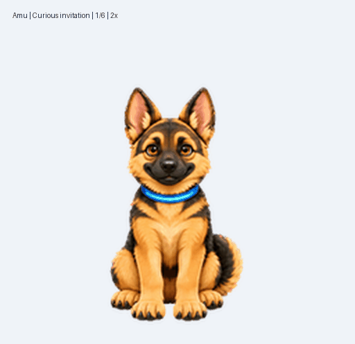

# 阿牧 · Amu

一只机警、亲人、动作柔和的 3D 毛绒风格德牧动画宠物。黑棕毛色、琥珀眼睛和蓝色青光项圈，陪你安静工作。

Version **1.1.0** — a 3D plush German Shepherd companion with nine animation states and sixteen look directions. This is rendered sprite artwork.



## 本地安装

下载并解压 [阿牧 v1.1.0 安装包](dist/amu-v1.1.0.zip)，把其中的 `amu` 文件夹放到 `~/.codex/pets/`，文件结构如下：

```text
~/.codex/pets/amu/
├── pet.json
├── spritesheet.png
└── version.json
```

已克隆仓库时，也可以运行：

```bash
python3 scripts/install.py
```

安装脚本只使用 Python 标准库，支持 `CODEX_HOME`，会在更新现有本地版本前备份原文件。相同版本重复安装不会写入文件。安装后在 **设置 → 宠物 → 刷新** 中选择阿牧。脚本不修改全局配置或账号设置。

根目录 `pet.json` 记录布局、版本和帧时长；[packages/amu/pet.json](packages/amu/pet.json) 是桌面应用使用的安装清单。[官方宠物说明](https://learn.chatgpt.com/docs/pets) 介绍了刷新和选择入口，具体可用能力取决于客户端版本。

## 预览与素材

- [透明精灵图](assets/spritesheet.png)：1536 × 2288 PNG，v2 布局，73 个有效帧。
- [趣味技能 GIF](previews/gentle-actions.gif) · [MP4](previews/gentle-actions.mp4)
- [九种动作 GIF](previews/all-states.gif) · [MP4](previews/all-states.mp4)
- [全部动作图](previews/contact-sheet.png) · [十六方向图](previews/directions.png)
- [动作和帧时长](pet.json) · [精灵图格式](docs/SPRITE_FORMAT.md)

## 动作

| 状态 | 内容 | 帧数 |
| --- | --- | ---: |
| idle | 呼吸、眨眼、听声耳动和尾尖轻摆 | 6 |
| running-right | 交替步态向右小跑 | 8 |
| running-left | 交替步态向左小跑 | 8 |
| waving | 低位击掌、半收爪回程，掌垫青光 | 4 |
| jumping | 小幅蓄力扑跳、柔软落地 | 5 |
| failed | 垂耳害羞、轻晃头再恢复 | 8 |
| waiting | 歪头探看、抬爪邀玩 | 6 |
| running | 坐姿嗅探巡查、项圈扫描 | 6 |
| review | 正面浅点头、满足眨眼与小吐舌 | 6 |

`running` 表示工作状态。趣味表现融入应用的固定动作状态，触发时机由应用控制。动画遵循原有帧数与帧时长，通过减小姿态跳变、加入蓄力和回程改善自然度。

## 文件

```text
assets/spritesheet.png   最终透明图集
assets/source/           3D 角色基准、动作条和方向条
assets/source/original/  当前动作的原始生成条带
packages/amu/           本地安装文件
scripts/install.py      本地安装及备份脚本
previews/               GIF、MP4、静帧和动作表
prompts/natural/        当前 3D 版生成及修正提示词
validation/             去除本机路径的验证记录
docs/                   格式与来源说明
pet.json                可移植的布局及播放时长
SHA256SUMS              文件校验值
```

`prompts/initial/` 和 `prompts/gentle/` 保留早期 2D 版本的创作记录。所有当前动作预览均从最终图集裁切，采用应用的原有帧时长。源图含可移除的洋红背景，最终图集背景透明。提示词无法保证随机生成逐像素复现。[制作过程与验证范围](docs/PROVENANCE.md) 记录了实际检查结果。

## 许可

本仓库内的素材、文档、安装脚本和提示词使用 [MIT License](LICENSE)。图像由 OpenAI 内置 ImageGen 生成，随后进行了背景移除、裁切、排列和边缘清理。仓库不包含 Pets 插件实现或其配套脚本，也不代表 OpenAI 官方作品。
